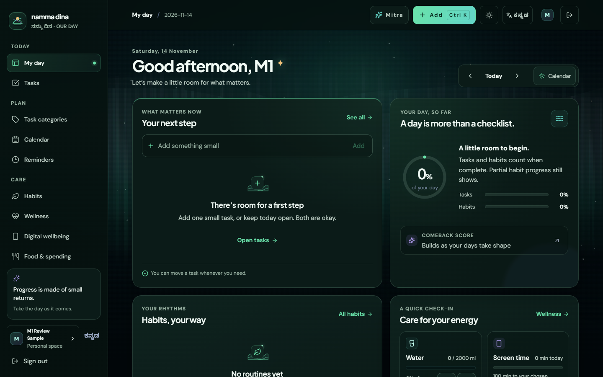
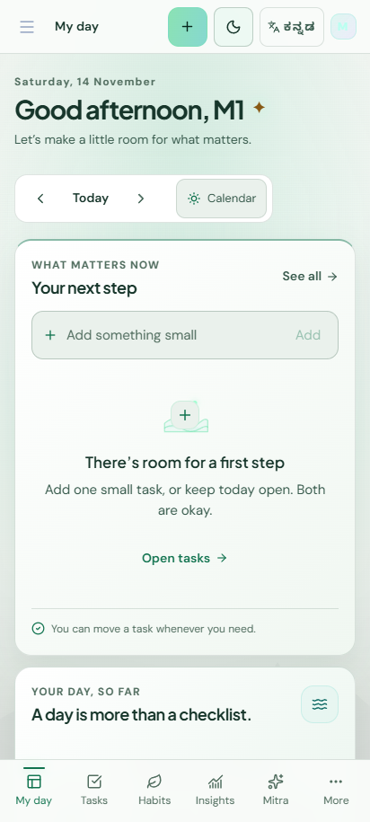

# Aurora background review

The app now uses an original Canvas 2D sky with folded emerald and teal aurora curtains, faint violet accents, fine star points, and the existing dark horizon treatment. It is intentionally subdued behind cards and navigation. The supplied Borealis page was treated as a visual reference; its shader and footage were not copied.

## Review coverage

- 24 screenshots: empty and populated dashboard states, English and Kannada, Aurora night and Aurora Day, at desktop (1440×900), tablet (768×1024), and mobile (412×915).
- The latest review produced 12 named short screen recordings in [videos](videos/). The folder also contains 36 anonymous `page@*.webm` recordings from earlier runs.
- The full visual pass reported zero page errors, horizontal overflow, and visible text below 12 px. See [review-metrics.json](review-metrics.json).
- A follow-up Axe check covered the brand link and Quick Add control in both locales at all three viewport sizes. It found zero violations; results are in [follow-up-review.json](follow-up-review.json).
- Motion-on changed the canvas; reduced motion rendered a still canvas. The same results are recorded in [follow-up-review.json](follow-up-review.json).

## Screenshots

## Design references

The sky combines the user-provided Borealis visual cue with a restrained central glow inspired by [Gemini](https://gemini.google.com/app), cinematic dark staging from [Google Flow](https://flow.google.com/about), and starfield depth from [GPT-6 Astra](https://openai.com/index/gpt-6-astra/). These are visual principles only; Namma Dina’s layout, code, colors, and assets remain original.

The dark responsive Figma frames use editable static vector treatments to document the live procedural canvas: [Namma Dina — Aurora design file](https://www.figma.com/design/SQ65u5myYg08VTUsDnKOxj).
